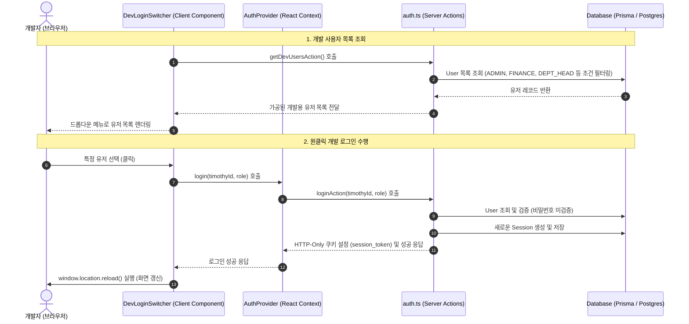

> **[안내]** 이 파일은 각 프로젝트가 복사해갈 때 프로젝트 상황에 맞게 수정하여 사용하는 템플릿이다.
> 적용 시 이 안내 문구를 제거하고 프로젝트에 맞게 내용을 수정한다.

# dev-login-expert Skill

개발용 로그인(Dev Login) 시스템 아키텍처 및 이식 가이드

이 문서는 프로젝트 개발 시 사용되는 개발용 원클릭 로그인(Mock Login) 시스템의 설계, 동작 방식 및 타 프로젝트로의 이식 방법을 설명한다.

---

## 1. 시스템 개요

개발용 로그인 시스템은 비프로덕션 환경(로컬 개발, 스테이징 등)에서 비밀번호 입력 없이 데이터베이스에 등록된 테스트 사용자 계정으로 즉시 로그인 및 역할(Role) 전환을 수행할 수 있도록 돕는 도구이다.

### 핵심 특징
- **안전성**: 프로덕션 환경(`production`)에서는 클라이언트 UI 노출 차단은 물론, 서버 사이드 액션에서도 2중으로 즉시 차단되도록 설계되었다.
- **세션 기반 인증**: JWT가 아닌 데이터베이스 저장 세션(Session Table) 방식을 따르며, 클라이언트는 HTTP-Only, Secure 속성이 적용된 `session_token` 쿠키를 공유한다.
- **역할 기반 전환**: 사용자의 권한(`ADMIN`, `FINANCE`, `PASTOR`, `DEPT_HEAD` 등) 및 다중 자격(`UserType`)을 실시간으로 갱신하여 결재 라인 및 권한별 화면을 테스트할 수 있다.

---

## 2. 시스템 아키텍처 및 데이터 흐름



---

## 3. 핵심 구성 요소 및 소스 코드

시스템을 다른 프로젝트로 가져가기 위해 필요한 5가지 핵심 코드 파일이다.

### ① 데이터베이스 스키마 (Prisma)
세션 관리 및 유저 역할 정보를 저장하는 데이터베이스 모델 정의이다.

```prisma
// prisma/schema.prisma

model User {
  id           Int        @id @default(autoincrement())
  timothyId    String     @unique                    // 시스템 내부 고유 ID
  username     String?    @unique                    // 로그인 아이디 (운영용)
  name         String                                // 이름
  role         String     @default("USER")           // 기본 역할 (ADMIN, FINANCE, PASTOR, DEPT_HEAD 등)
  departmentId String?    @map("department_id")      // 소속 부서 ID
  isActive     Boolean    @default(true) @map("is_active")
  createdAt    DateTime   @default(now())
  updatedAt    DateTime   @updatedAt
  sessions     Session[]
  types        UserType[]                            // 다중 자격 관계
}

model Session {
  id           Int      @id @default(autoincrement())
  sessionToken String   @unique @map("session_token")
  userId       Int      @map("user_id")
  expiresAt    DateTime @map("expires_at")
  createdAt    DateTime @default(now()) @map("created_at")
  user         User     @relation(fields: [userId], references: [id], onDelete: Cascade)

  @@map("user_session")
}

model UserType {
  id        Int      @id @default(autoincrement())
  userId    Int      @map("user_id")
  type      String   // 예: "REGULAR" | "ASSOCIATE" | "CLERGY" | "OFFICER" | "DEPT_HEAD"
  createdAt DateTime @default(now()) @map("created_at")
  user      User     @relation(fields: [userId], references: [id], onDelete: Cascade)

  @@unique([userId, type])
  @@map("user_type")
}
```

### ② 서버 측 인증 유틸리티
쿠키를 통해 현재 로그인한 사용자 세션을 DB에서 역조회하는 유틸리티이다.

```typescript
// lib/auth.ts
"use server";

import { cookies } from "next/headers";
import { prisma } from "@/lib/prisma"; // DB 클라이언트 인스턴스

export type Role = "USER" | "DEPT_HEAD" | "FINANCE" | "FINANCE_HEAD" | "PASTOR" | "SENIOR_PASTOR" | "ADMIN";

export interface ServerUser {
  id: string;
  timothyId: string;
  name: string;
  role: Role;
  departmentId?: string;
  types: string[];
}

export async function getServerUser(): Promise<ServerUser | null> {
  try {
    const cookieStore = await cookies();
    const sessionToken = cookieStore.get("session_token")?.value;
    if (!sessionToken) return null;

    const session = await prisma.session.findUnique({
      where: { sessionToken },
      include: {
        user: {
          select: {
            id: true,
            timothyId: true,
            name: true,
            role: true,
            departmentId: true,
            isActive: true,
            types: { select: { type: true } }
          }
        }
      }
    });

    if (!session || !session.user || !session.user.isActive) {
      return null;
    }

    // 만료일 검증
    if (session.expiresAt <= new Date()) {
      void prisma.session.delete({ where: { id: session.id } }).catch(() => {});
      return null;
    }

    return {
      id: String(session.user.id),
      timothyId: session.user.timothyId,
      name: session.user.name,
      role: session.user.role as Role,
      departmentId: session.user.departmentId ?? undefined,
      types: session.user.types.map(t => t.type),
    };
  } catch (err) {
    console.error("getServerUser error:", err);
    return null;
  }
}
```

### ③ 서버 액션 (Server Actions)
비프로덕션 환경인 경우에만 활성화되어 로그인 세션을 신속하게 생성하는 비즈니스 로직이다.

```typescript
// actions/auth.ts
"use server";

import { prisma } from "@/lib/prisma";
import { cookies } from "next/headers";

// 1) 개발용 유저 목록 반환 (프로덕션 환경에서는 강제 빈 배열 반환)
export async function getDevUsersAction() {
  try {
    const isProd = process.env.APP_ENV === "production" || (!process.env.APP_ENV && process.env.NODE_ENV === "production");
    if (isProd) return [];

    const users = await prisma.user.findMany({
      where: {
        OR: [
          { role: { in: ["ADMIN", "FINANCE", "PASTOR", "SENIOR_PASTOR", "DEPT_HEAD"] } },
          { types: { some: {} } },
          { departmentId: { not: null } }
        ]
      },
      orderBy: { id: "asc" },
      include: { types: { select: { type: true } } }
    });

    return users.map(u => ({
      id: String(u.id),
      timothyId: u.timothyId,
      name: u.name,
      role: u.role,
      departmentId: u.departmentId ?? undefined,
      types: u.types.map(t => t.type)
    }));
  } catch (err) {
    console.error("Failed to get dev users:", err);
    return [];
  }
}

// 2) 개발용 패스워드리스 로그인 액션
export async function loginAction(timothyId: string, role: string) {
  try {
    const isProd = process.env.APP_ENV === "production" || (!process.env.APP_ENV && process.env.NODE_ENV === "production");
    if (isProd) {
      return { success: false, error: "이 기능은 프로덕션 환경에서 사용할 수 없다." };
    }

    const user = await prisma.user.findFirst({
      where: { timothyId, role },
      include: { types: { select: { type: true } } }
    });

    if (!user) {
      return { success: false, error: "등록되지 않은 사용자이거나 권한이 일치하지 않다." };
    }

    // 무작위 세션 토큰 생성 (32바이트 16진수)
    const crypto = await import("crypto");
    const sessionToken = crypto.randomBytes(32).toString("hex");
    const expiresAt = new Date(Date.now() + 24 * 60 * 60 * 1000); // 24시간 후 만료

    await prisma.session.create({
      data: { sessionToken, userId: user.id, expiresAt }
    });

    const cookieStore = await cookies();
    cookieStore.set("session_token", sessionToken, {
      httpOnly: true,
      secure: process.env.NODE_ENV === "production",
      sameSite: "lax",
      maxAge: 24 * 60 * 60, // 24시간 (단위: 초)
      path: "/"
    });

    return {
      success: true,
      user: {
        id: String(user.id),
        timothyId: user.timothyId,
        name: user.name,
        role: user.role,
        departmentId: user.departmentId ?? undefined,
        types: user.types.map(t => t.type)
      }
    };
  } catch (err) {
    console.error("Login action error:", err);
    return { success: false, error: "로그인 처리 중 오류가 발생했다." };
  }
}

// 3) 로그아웃 액션
export async function logoutAction() {
  try {
    const cookieStore = await cookies();
    const sessionToken = cookieStore.get("session_token")?.value;

    if (sessionToken) {
      await prisma.session.deleteMany({ where: { sessionToken } });
    }

    cookieStore.set("session_token", "", {
      httpOnly: true,
      secure: process.env.NODE_ENV === "production",
      sameSite: "lax",
      maxAge: 0, // 쿠키 즉시 만료
      path: "/"
    });

    return { success: true };
  } catch (err) {
    console.error("Logout error:", err);
    return { success: false, error: "로그아웃 처리 중 오류가 발생했다." };
  }
}
```

### ④ React Context 인증 공급자 (Auth Provider)
클라이언트 전역에 로그인 상태와 메서드를 주입하는 Context이다.

```typescript
// context/auth-context.tsx
"use client";

import React, { createContext, useContext, useEffect, useState } from "react";
import { loginAction, logoutAction, getCurrentUserAction } from "@/actions/auth";

export type Role = "USER" | "DEPT_HEAD" | "FINANCE" | "FINANCE_HEAD" | "PASTOR" | "SENIOR_PASTOR" | "ADMIN";

export interface AuthUser {
  id: string;
  timothyId: string;
  name: string;
  role: Role;
  departmentId?: string;
  types?: string[];
}

interface AuthContextType {
  user: AuthUser | null;
  login: (timothyId: string, role: Role) => Promise<{ success: boolean; error?: string }>;
  logout: () => Promise<void>;
  isLoading: boolean;
}

const AuthContext = createContext<AuthContextType | undefined>(undefined);

export function AuthProvider({ children }: { children: React.ReactNode }) {
  const [user, setUser] = useState<AuthUser | null>(null);
  const [isLoading, setIsLoading] = useState(true);

  // 마운트 시 기존 세션 쿠키 여부 확인하여 유저 로드
  useEffect(() => {
    async function loadSession() {
      try {
        const currentUser = await getCurrentUserAction();
        setUser(currentUser ? (currentUser as AuthUser) : null);
      } catch (e) {
        console.error("Failed to load session", e);
      } finally {
        setIsLoading(false);
      }
    }
    loadSession();
  }, []);

  const login = async (timothyId: string, role: Role) => {
    setIsLoading(true);
    try {
      const res = await loginAction(timothyId, role);
      if (res.success && res.user) {
        setUser(res.user as AuthUser);
        return { success: true };
      }
      return { success: false, error: res.error };
    } catch (err) {
      return { success: false, error: "로그인 중 예외가 발생했다." };
    } finally {
      setIsLoading(false);
    }
  };

  const logout = async () => {
    setIsLoading(true);
    try {
      await logoutAction();
      setUser(null);
    } finally {
      setIsLoading(false);
    }
  };

  return (
    <AuthContext.Provider value={{ user, login, logout, isLoading }}>
      {!isLoading && children}
    </AuthContext.Provider>
  );
}

export function useAuth() {
  const context = useContext(AuthContext);
  if (context === undefined) {
    throw new Error("useAuth는 AuthProvider 내부에서만 사용할 수 있다.");
  }
  return context;
}
```

### ⑤ UI 컴포넌트 (`DevLoginSwitcher`)
개발 환경에서만 렌더링되며, 클릭 시 사용자 목록을 로드하고 원클릭 로그인을 처리하는 Tailwind CSS 기반 드롭다운 UI 컴포넌트이다.

```tsx
// components/auth/dev-login-switcher.tsx
"use client";

import { useEffect, useState } from "react";
import { useAuth, Role } from "@/context/auth-context";
import { Button } from "@/components/ui/button";
import {
  DropdownMenu,
  DropdownMenuContent,
  DropdownMenuItem,
  DropdownMenuTrigger,
} from "@/components/ui/dropdown-menu";
import { UserCircle } from "lucide-react";
import { getDevUsersAction } from "@/actions/auth";

interface DbUser {
  id: string;
  timothyId: string;
  name: string;
  role: string;
  departmentId?: string;
  types?: string[];
}

export function DevLoginSwitcher() {
  const { user, login, logout } = useAuth();
  const [dbUsers, setDbUsers] = useState<DbUser[]>([]);
  
  // 클라이언트 측 환경 검사
  const isDev = process.env.NEXT_PUBLIC_APP_ENV !== "production";
  if (!isDev) return null;

  useEffect(() => {
    async function fetchUsers() {
      const users = await getDevUsersAction();
      
      // 이름 기준으로 중복 제거하되 가짜 계정(T_로 시작)보다 실제 DB 계정을 우선시
      const userMap = new Map<string, DbUser>();
      for (const u of users) {
        if (!userMap.has(u.name)) {
          userMap.set(u.name, u);
        } else {
          const existing = userMap.get(u.name)!;
          if (
            (existing.timothyId.startsWith("T_") && !u.timothyId.startsWith("T_")) || 
            (!existing.departmentId && u.departmentId)
          ) {
            userMap.set(u.name, u);
          }
        }
      }
      const uniqueUsers = Array.from(userMap.values());
      uniqueUsers.sort((a, b) => a.name.localeCompare(b.name, "ko-KR"));
      setDbUsers(uniqueUsers);
    }
    fetchUsers();
  }, []);

  const handleLogin = async (timothyId: string, role: string) => {
    const res = await login(timothyId, role as Role);
    if (res.success) {
      window.location.reload(); // 세션 주입 후 전체 화면 새로고침
    } else {
      alert(`로그인 실패: ${res.error}`);
    }
  };

  const handleLogout = async () => {
    await logout();
    window.location.href = "/";
  };

  return (
    <div className="z-50 fixed bottom-4 right-4">
      <DropdownMenu>
        <DropdownMenuTrigger asChild>
          <Button variant={user ? "default" : "outline"} className="shadow-lg rounded-full">
            <UserCircle className="w-5 h-5 mr-2" />
            {user ? `${user.name} (${user.role})` : "Dev Login"}
          </Button>
        </DropdownMenuTrigger>
        <DropdownMenuContent align="end" className="max-h-96 overflow-y-auto w-48">
          {user && (
            <>
              <DropdownMenuItem onClick={handleLogout} className="text-destructive font-bold cursor-pointer">
                로그아웃
              </DropdownMenuItem>
              <div className="border-b my-1" />
            </>
          )}
          {dbUsers.map((dbUser) => (
            <DropdownMenuItem 
              key={`${dbUser.timothyId}-${dbUser.role}`} 
              onClick={() => handleLogin(dbUser.timothyId, dbUser.role)}
              className="cursor-pointer"
            >
              <span className="font-semibold">{dbUser.name}</span>
              <span className="text-[10px] text-muted-foreground ml-auto">{dbUser.role}</span>
            </DropdownMenuItem>
          ))}
        </DropdownMenuContent>
      </DropdownMenu>
    </div>
  );
}
```

### ⑥ 개발자 계정 전환(Dev Switcher) 시 경로 보존 및 권한별 안전 라우팅

사용자가 특정 페이지(예: `/auction`, `/notices`, `/admin/posts` 등)를 탐색하던 중 상단 프로필 헤더나 개발자 스위처 드롭다운을 통해 계정을 바꿀 때 원래 보던 페이지 흐름을 유지하고 권한 충돌로 인한 404를 방지해야 한다.

1. **현재 머물던 경로(`redirectPath`) 전달**:
   - `switchDevUser` 서버 액션은 반드시 `formData.get('redirectPath')`를 수신하여 목표 URL을 결정한다.
2. **권한별 안전 라우팅 유틸 (`getDevLoginRedirectPath`) 필수 적용**:
   - 대상 역할이 관리자(`DEV_ADMIN_ROLES`)인 경우: 원래 머물던 어드민 또는 일반 페이지 경로를 유지한다.
   - 대상 역할이 일반 유저인 경우: 어드민 경로(`/admin/...`)에 머물고 있었다면 권한이 없으므로 안전하게 메인 홈(`/`)으로 리다이렉트하여 404 및 미들웨어 가드 충돌을 방지한다.
   - 오픈 리다이렉트 방지: `//` 또는 `http(s)://`로 시작하는 외부 URL은 무조건 `/`로 폴백한다.
3. **클라이언트 동적 경로 동기화**:
   - Next.js SPA 클라이언트 내비게이션 시 SSR 초기값 고착을 방지하기 위해 `usePathname()` 훅과 `onSubmit` 폼 제출 이벤트 핸들러를 결합하여 최신 `window.location.pathname + window.location.search`를 동적으로 주입한다.

---

## 4. 타 프로젝트 이식 가이드

이 시스템을 새로운 프로젝트에 이식할 때 주의할 체크리스트이다.

### 1단계: 환경 변수 설정
클라이언트 및 서버 측에서 비프로덕션 환경을 명확히 정의하기 위해 두 개의 키를 추가해야 한다.
- **클라이언트 검사용**: `NEXT_PUBLIC_APP_ENV`
  - `.env.local` 또는 `.env.development`에 `NEXT_PUBLIC_APP_ENV=development`로 설정한다.
  - 프로덕션 환경에는 `NEXT_PUBLIC_APP_ENV=production` 또는 값을 생략한다.
- **서버 검사용**: `APP_ENV`
  - 서버 측 실행 스크립트 또는 빌드 파이프라인에서 `APP_ENV=development`로 주입한다.

### 2단계: UI 라이브러리 의존성
예시의 `DevLoginSwitcher` 컴포넌트는 다음 UI 라이브러리를 의존하고 있다. 대상 프로젝트에 맞게 교체하거나 설치해야 한다.
- **Tailwind CSS** (스타일링)
- **Radix UI Dropdown Menu** (`@/components/ui/dropdown-menu`로 감싸져 있음)
  - 만약 해당 컴포넌트가 없거나 다른 라이브러리(예: Headless UI, Material UI 등)를 사용한다면 일반 HTML `<select>` 태그나 직접 구현한 드롭다운 UI로 대체할 수 있다.
- **Lucide React** (`UserCircle` 아이콘)

### 3단계: Global Layout에 컴포넌트 마운트
루트 레이아웃 파일에 `AuthProvider`로 전체 영역을 감싸고, `DevLoginSwitcher` 컴포넌트를 마운트한다.

```tsx
// app/layout.tsx
import { AuthProvider } from "@/context/auth-context";
import { DevLoginSwitcher } from "@/components/auth/dev-login-switcher";

export default function RootLayout({ children }: { children: React.ReactNode }) {
  return (
    <html>
      <body>
        <AuthProvider>
          {children}
          <DevLoginSwitcher />
        </AuthProvider>
      </body>
    </html>
  );
}
```

### 4단계: 보안 점검
운영 환경에 배포하기 전에 반드시 다음 사항을 이중 확인하십시오.
1. 빌드 결과물에 `NEXT_PUBLIC_APP_ENV=production` 상태에서 화면 하단에 `Dev Login` 버튼이 렌더링되지 않는지 로컬에서 확인한다.
2. cURL 등을 활용하여 서버 액션인 `loginAction`에 직접 POST 요청을 보냈을 때 `APP_ENV=production` 하에서 에러를 반환하는지 검증한다.

---

## 5. 테마 및 색상 정의

이 시스템의 UI는 다음의 프리미엄 테마 색상을 기반으로 설계되었다. 타 프로젝트 이식 시 참고하십시오.

### 라이트 모드 테마 색상

| 색상 변수 | 색상값 | 설명 |
| :--- | :--- | :--- |
| `--primary` | `oklch(0.205 0 0)` | 메인 브랜드 텍스트 및 기본 요소 색상 |
| `--button-primary-bg` | `#129C49` | 기본 초록색 버튼 |
| `--button-primary-outlined-bg` | `#effff5` | 초록색 라인 버튼 배경색 |
| `--button-primary-purple-bg` | `#7350c1` | 서브 브랜드 보라색 버튼 |
| `--button-destructive-bg` | `#fff2f3` | 삭제/경고 버튼 배경색 |
| `--sidebar-primary` | `#0a331c` | 사이드바 라이트 모드 메인 포레스트 그린 |

### 다크 모드 테마 색상

다크 모드는 키오스크 테마에서 영감을 받은 **Slate-950 기반의 딥 다크 톤**과 **Green-500의 네온 글로우 포인트**로 구성되어 있다.

| 색상 변수 | 색상값 | 설명 |
| :--- | :--- | :--- |
| `--background` | `#020617` | 다크 모드 메인 배경색 (Slate 950) |
| `--foreground` | `#e2e8f0` | 다크 모드 메인 텍스트색 (Slate 200) |
| `--card` / `--sidebar` | `#0f172a` | 카드 및 사이드바 배경색 (Slate 900) |
| `--primary` | `#22c55e` | 기본 브랜드 초록색 포인트 (Green 500) |
| `--secondary` / `--muted` | `#1e293b` | 보조 요소 및 음영 배경색 (Slate 800) |
| `--accent` | `#052e16` | 포커스 및 강조용 딥 그린 배경 (Green 950) |
| `--accent-foreground` | `#bbf7d0` | 강조 텍스트색 (Green 200) |
| `--border` | `rgba(148, 163, 184, 0.12)` | 슬레이트 400 대비 투명 테두리 |
