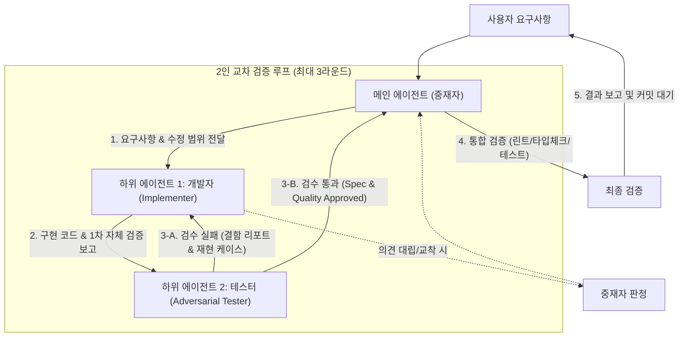

# invite-tester — 개발자·비판적 테스터 2인 교차 검증 스킬

한 에이전트가 코드를 작성하고 스스로 검토하면 **확증 편향(Confirmation Bias)**으로 인해 엣지 케이스나 잠재 결함을 놓치기 쉽습니다.  
`dev-tester-loop`는 구현자(Developer)와 비판적 검수자(Adversarial Tester)의 역할을 명확히 분리하고, 메인 에이전트가 중재자(Orchestrator)로서 핑퐁 루프를 조율하여 결점 없는 결과물을 사용자에게 전달합니다.

---

## 1. 아키텍처 및 역할 정의



### 세부 역할

| 역할 | 담당 주체 | 핵심 책임 및 행동 강령 |
| :--- | :--- | :--- |
| **중재자 (Orchestrator)** | 메인 에이전트 | - 요구사항 분해 및 수정 범위(Scope) 선언<br>- 개발자 및 테스터 에이전트 순차/교차 위임<br>- 루프 라운드 카운팅 (최대 3회 제한)<br>- 이견 발생 시 프로젝트 규칙 기준으로 중재 판정<br>- 최종 통합 검증 및 사용자 보고 |
| **개발자 (Implementer)** | 하위 에이전트 1 | - 선언된 범위 내에서 외과적 코드 구현<br>- 기본 해피 패스(Happy path) 단위 테스트 작성<br>- 테스터의 결함 지적에 대해 변명 없이 즉각 원인 분석 및 수정<br>- 수정 범위 밖의 파일 무단 변경 금지 |
| **테스터 (Adversarial Tester)** | 하위 에이전트 2 | - **"이 코드에는 반드시 버그가 있다"**는 가설 기반 비판적 검수<br>- 엣지 케이스(경계값, null/undefined, 비동기 레이스 등) 공격 테스트 작성 및 실행<br>- 프로젝트 공통 안티패턴(Fire-and-forget, 스키마 불일치, 하드코딩 등) 정밀 검사<br>- 결함 발견 시 **구체적 재현 시나리오와 실패 테스트 코드**를 첨부하여 반환 |

---

## 2. 적용 기준 (When to Use)

- **적용 대상 (권장)**:
  - 새로운 기능 구현, 신규 API 라우트/컴포넌트 개발
  - 복잡한 비즈니스 로직 및 상태 머신 변경
  - 다중 파일 리팩토링 및 데이터베이스 스키마 연동 작업
  - 재현이 까다로운 고난도 버그 수정
- **적용 제외 (오버헤드 방지)**:
  - 1-2개 파일의 단순 오타, 텍스트 라벨 변경
  - 단순 CSS 여백/색상 미세 조정
  - 문서(마크다운) 오탈자 수정

---

## 3. 단계별 워크플로우

### Phase 1: 스펙 확정 및 수정 범위 선언 (중재자)
1. 요구사항을 분석하고 구현할 파일 목록(Scope)과 완료 기준을 정의합니다.
2. 현재 작업 브랜치 및 테스트 베이스라인 상태를 확인합니다.

### Phase 2: 개발자 위임 (Implementer)
- 하위 에이전트(개발자)를 호출하여 구현을 지시합니다:
  ```markdown
  당신은 구현을 담당하는 시니어 소프트웨어 엔지니어입니다.
  요구사항: [상세 요구사항]
  수정 허용 파일: [선언된 파일 목록]
  완료 조건: 구현 완료 후 단위 테스트를 작성하고 실행 결과를 보고하세요.
  ```
- 개발자가 구현 코드 및 1차 테스트 결과를 보고하면 Phase 3으로 진행합니다.

### Phase 3: 비판적 테스터 위임 (Adversarial Tester)
- 하위 에이전트(테스터)를 호출하여 가혹한 검수를 지시합니다:
  ```markdown
  당신은 결함을 찾아내는 비판적 QA/시니어 리뷰어입니다.
  검토 대상 변경 내용: [개발자가 수정한 파일 및 코드 diff]
  임무:
  1. 구현 코드의 엣지 케이스, 경계값, 예외 처리 누락을 찾아내고 공격 테스트를 작성해 검증하세요.
  2. 안티패턴(비동기 await 누락, 스키마 불일치, 하드코딩 fallback, 보안 취약점)을 전수 검사하세요.
  3. 결함이 발견되면 [결함 리포트]를 작성하여 반환하고, 모든 검증을 통과하면 [PASS]를 선언하세요.
  ```

### Phase 4: 피드백 루프 및 라운드 제어 (최대 3회)
- **테스터가 결함을 보고한 경우**:
  - 중재자는 라운드 카운트를 1 증가시킵니다 (현재 라운드 $R$).
  - **$R \le 3$**: 개발자 에이전트에게 테스터의 결함 리포트와 실패 테스트를 전달하여 수정을 요구합니다. (수정 완료 후 다시 Phase 3으로 테스터 재검수)
  - **$R > 3$ (회로 차단기 / Circuit Breaker)**:
    - 3회 이상 핑퐁이 지속되면 무한 루프를 방지하기 위해 중재자가 직접 개입합니다.
    - 잔여 이슈가 치명적인지(Blocking) 사소한지(Minor) 판정합니다.
    - 치명적 이슈인 경우 작업을 중단하고 사용자에게 상황을 에스컬레이션하며, 경미한 사항은 중재자가 직접 조율하여 마무리합니다.
- **테스터가 [PASS]를 선언한 경우**:
  - 교차 검증 루프를 성공적으로 종료하고 Phase 5로 이동합니다.

### Phase 5: 중재자 통합 검증 및 사용자 보고
1. 중재자가 전체 프로젝트 빌드, 타입 체크, 전체 테스트 스위트를 직접 실행하여 회귀 버그가 없는지 확인합니다.
2. 검증 완료 후 변경 사항을 작업 단위별로 정리합니다.
3. 사용자에게 다음 형식으로 최종 보고합니다:
   - 구현 요약 및 변경 파일 목록
   - 교차 검증 라운드 경과 (예: 1라운드 2건 결함 발견 후 2라운드 전원 통과)
   - 테스터가 추가한 방어 테스트 목록
   - 검증 실행 결과 (Type-check / Test 결과)

---

## 4. 하위 에이전트 프롬프트 가이드

### 개발자 에이전트 프롬프트 요약
- [developer-prompt.md](./developer-prompt.md) 참조
- 범위 밖 파일 수정 금지
- 단순한 코드 우선 (KISS, YAGNI)
- 에러 삼키기 금지, 명확한 타입 타이핑

### 테스터 에이전트 프롬프트 요약
- [tester-prompt.md](./tester-prompt.md) 참조
- 비판적 시각 유지 (착한 리뷰어 금지)
- 7대 금기 안티패턴 체크리스트 점검
- 단순 지적에 그치지 않고 실패하는 재현 테스트 코드 필수 작성

---

## 5. 완료 체크리스트 (Definition of Done)

- [ ] 개발자가 구현을 완료하고 자체 테스트를 통과했는가?
- [ ] 테스터가 엣지 케이스 및 안티패턴을 비판적으로 검수했는가?
- [ ] 테스터 지적 사항이 개발자에 의해 완전히 수정 및 재검증되었는가?
- [ ] 피드백 루프가 3회 이내에 정상 수렴(PASS)했는가?
- [ ] 중재자가 프로젝트 전체 린트/타입체크/테스트 무결성을 최종 확인했는가?
- [ ] 진행 과정과 결과가 사용자에게 투명하게 요약 보고되었는가?
