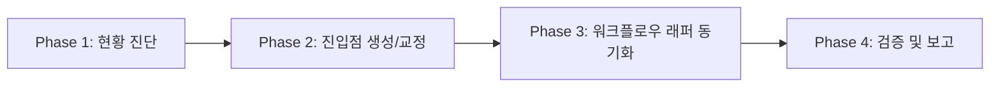

# 다중 AI 도구 공존 구조 초기화 스킬 (multi-agent-init)

프로젝트에 다양한 AI 코딩 에이전트(Claude Code, Antigravity, Gemini, Cursor 등)를 함께 사용할 때, 단일 SSOT(단일 진실 공급원) + 얇은 래퍼(Thin Wrapper) 원칙에 기반하여 디렉터리 구조와 진입점을 자동으로 구성하고 규칙 중복을 방지·검증하는 표준 스킬입니다.

---

## 1. 핵심 설계 원칙

### 원칙 1 — 프로젝트 메인 문서(SSOT) 중심 (진입점은 얇은 래퍼)
- 프로젝트 전역 개발 컨벤션, 아키텍처 원칙, 보안 표준은 **프로젝트 SSOT(예: `AGENTS.md`)**에만 단 한 번 작성합니다.
- `CLAUDE.md`, `.cursorrules`, `GEMINI.md` 등의 개별 AI 진입점 파일은 규칙 본문을 직접 복제하지 않고, 프로젝트 메인 SSOT를 가리키는 **10~20줄 내외의 얇은 래퍼(Thin Wrapper)**로만 유지합니다.

### 원칙 2 — `.agents/` 디렉터리가 공용 자산(스킬, 워크플로우, 룰)의 유일한 원본
- **스킬**: `.agents/skills/<name>/SKILL.md`에 단 한 번만 작성하며 모든 AI 도구가 공통으로 탐색합니다.
- **워크플로우**: `.agents/workflows/<name>.md`에 원본을 유지합니다.
- **AI 룰**: `.agents/rules/*.md`에 도메인별 보조 룰을 유지하며 메인 SSOT와 내용이 겹치지 않도록 관리합니다.

### 원칙 3 — AI별 비대칭 및 전용 설정의 래퍼화
- AI 도구별 전용 슬래시 커맨드 디렉터리에는 자체 로직을 작성하지 않고, `.agents/workflows/`를 참조하는 래퍼만 생성합니다.
- `.agents/`를 네이티브로 직접 참조할 수 있는 도구는 별도 복제 디렉터리를 만들지 않습니다.

---

## 2. 트리거 조건

다음과 같은 상황에서 이 스킬을 활성화합니다:
- "멀티 에이전트 설정해줘", "다중 AI 공존 세팅", "에이전트 구조 초기화"
- "AGENTS.md 진입점 동기화", "새로운 AI 도구 연동"
- 프로젝트 루트에 다중 AI 진입점이 누락되었거나 규칙/스킬 중복이 의심될 때

---

## 3. 실행 절차 (Execution Phases)



### Phase 1 — 현황 진단

프로젝트 루트 및 관련 설정 디렉터리의 상태를 스캔합니다.

```bash
# 1. 진입점 및 SSOT 파일 확인
ls -la AGENTS.md CLAUDE.md README.md .cursorrules GEMINI.md 2>/dev/null

# 2. 공용 자산 및 전용 래퍼 디렉터리 확인
ls -la .agents/ .agents/skills/ .agents/workflows/ .agents/rules/ 2>/dev/null
```

**상태별 진단 및 조치 매트릭스**:

| 진단 상태 | 원인 및 현상 | 대응 조치 |
| :--- | :--- | :--- |
| **SSOT 문서 없음** | 메인 규칙(`AGENTS.md`)이 없음 | 에이전트 실행 중단 후 사용자에게 SSOT 생성/지정 요청 |
| **진입점 누락** | 특정 AI 도구의 진입점 파일 부재 | Phase 2의 표준 얇은 래퍼 템플릿으로 생성 |
| **진입점 비대화 (SSOT 위반)** | 진입점에 전체 규칙이 직접 복제됨 | 규칙 본문을 SSOT로 일원화하고 진입점은 얇은 포인터로 축소 |
| **전용 커맨드 로직 중복** | AI 도구별 커맨드 디렉터리에 로직이 직접 작성됨 | 내용을 `.agents/workflows/`로 승격하고 래퍼로 교체 |

---

### Phase 2 — 진입점 생성 및 교정

누락된 진입점이 있거나 SSOT 위반이 발견된 경우 표준 템플릿에 따라 생성/수정합니다.

#### 올바른 SSOT 문서 구조 (`AGENTS.md`)
```markdown
# AGENTS.md — 프로젝트 전역 개발 및 AI 정책 (단일 진실 공급원)

> [!IMPORTANT]
> **본 문서가 이 프로젝트의 유일한 단일 진실 공급원(SSOT)입니다.**

## 0. 문서 위계 및 진입점
- 본 문서 (`AGENTS.md`): 단일 진실 공급원 (SSOT)
- `CLAUDE.md`: Claude Code 진입점 (본 문서 포인터)
- `.agents/skills/*`: 작업 유형별 실행 절차서
- `.agents/workflows/*`: 다단계 작업 워크플로우 원본

... (프로젝트 핵심 규칙 기술) ...
```

#### 올바른 얇은 진입점 (Claude Code, Cursor 등)
```markdown
# CLAUDE.md

> **이 파일은 얇은 진입점(Thin Entry Point)입니다.**
> 프로젝트의 단일 진실 공급원(SSOT)은 `AGENTS.md`에 정의되어 있습니다.

## 1. 읽기 순서 (Read Order)
1. `AGENTS.md` (프로젝트 루트 단일 진실 공급원)
2. `.agents/rules/*.md` (필요 시 도메인별 보조 룰)

## 2. 스킬 및 워크플로우
- 모든 스킬 원본: `.agents/skills/`
- 모든 워크플로우 원본: `.agents/workflows/`
```

---

### Phase 3 — 워크플로우 래퍼 동기화

`.agents/workflows/`에 정의된 워크플로우를 타 AI 도구가 인식할 수 있도록 래퍼를 자동 동기화합니다.

```bash
# 워크플로우 래퍼 동기화 (Claude Code 예시)
mkdir -p .claude/commands

if [ -d ".agents/workflows" ]; then
  for wf in .agents/workflows/*.md; do
    [ -f "$wf" ] || continue
    fname=$(basename "$wf")
    target=".claude/commands/$fname"
    expected_content="@../../.agents/workflows/$fname"
    if [ ! -f "$target" ] || [ "$(cat "$target")" != "$expected_content" ]; then
      echo "$expected_content" > "$target"
      echo "[동기화 완료] $target -> $expected_content"
    fi
  done
fi
```

---

### Phase 4 — 검증 및 보고

```markdown
### 다중 AI 공존 구조 검증 결과

| 점검 항목 | 대상 경로 | 상태 | 조치 내용 |
| :--- | :--- | :---: | :--- |
| **단일 진실 공급원 (SSOT)** | `AGENTS.md` | ✅ | 유일 원본 확인 완료 |
| **AI 진입점** | `CLAUDE.md` 등 | ✅ | 얇은 래퍼 적용 |
| **공용 스킬 디렉터리** | `.agents/skills/` | ✅ | N개 스킬 원본 유지 |
| **워크플로우 래퍼** | AI별 커맨드 디렉터리 | ✅ | N개 커맨드 래퍼 연결 |
| **SSOT 위반(중복) 항목** | - | ✅ 0건 | 중복 작성 해소 |
```

---

## 4. SSOT 위반 감지 및 시정 규칙

에이전트는 다음 3가지 패턴을 감지했을 때 즉시 SSOT 위반으로 판정하고 시정합니다:

1. **진입점 내 규칙 중복 복제**: 진입점 파일에 수십 줄 이상의 규칙이 하드코딩된 경우 → SSOT로 통합 후 포인터로 치환.
2. **AI별 커맨드 디렉터리 내 자체 로직**: 워크플로우 원본이 아닌 마크다운 본문이 직접 포함된 경우 → `.agents/workflows/`로 승격 후 래퍼로 교체.
3. **스킬/워크플로우 다중 디렉터리 분산**: 동일 스킬이 여러 AI 도구 디렉터리에 복제된 경우 → `.agents/skills/`를 유일 원본으로 삼고 복제본 제거.
