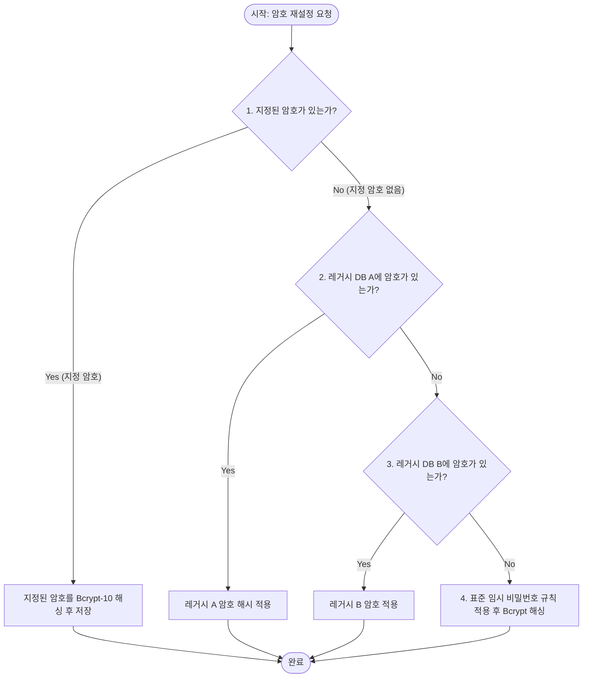

> **[안내]** 이 파일은 각 프로젝트가 복사해갈 때 프로젝트 상황에 맞게 수정하여 사용하는 템플릿이다.

# Password Reset Expert — 비밀번호 재설정 전문가

사용자 계정의 비밀번호를 안전하고 체계적으로 재설정하는 로직과 우선순위를 정의한다.

## 1. 비밀번호 재설정 비즈니스 규칙 (우선순위)



### 1단계: 지정된 암호가 전달된 경우 (Explicit Password)
* 사용자가 요청 시 암호를 직접 지정한 경우 최우선으로 사용한다.
* 전달된 원문 암호는 반드시 **`bcrypt` (Cost Factor: 10 이상)**를 사용하여 해싱한 뒤 DB에 저장해야 한다.

### 2단계: 사용자 식별 및 조회 (User Identification)
* 입력된 `id` 또는 `email`이 데이터베이스의 사용자 식별 컬럼(`login_id`, `email`, `user_id`)과 일치하는지 먼저 확인한다.

### 3단계: 지정 암호가 없는 경우 (Fallback & 임시 비밀번호 규칙)
지정 암호가 없을 때 다음과 같은 순서로 처리합니다:

1. **레거시 회원 DB 암호 복구**: 레거시 DB(예: 기존 회원 테이블)에 남아있는 기존 비밀번호 해시값이 유효하다면 이관 및 적용한다.
2. **표준 임시 비밀번호 규칙 적용**:
   * 레거시 비밀번호가 존재하지 않거나 초기화인 경우 프로젝트 표준 임시 비밀번호 규칙을 적용한다.
   * **임시 비밀번호 원문 규칙 예시**: `<prefix>` + `<login_id>` (예: `temp` + `login_id` ➔ `temp12345`)
   * 생성된 임시 비밀번호 원문을 **`bcrypt` (Cost Factor: 10)**로 해싱하여 반영한다.

---

## 2. 구현 예시 (TypeScript & Node.js)

```typescript
import * as bcrypt from 'bcrypt';

const BCRYPT_ROUNDS = 10;

export async function generateResetPassword(loginId: string, customPassword?: string): Promise<{ rawPass: string; hashedPass: string }> {
  // 1. 지정 암호가 있으면 우선 사용, 없으면 규칙 기반 임시 비밀번호 생성
  const rawPass = customPassword || `temp${loginId}`;
  
  // 2. Bcrypt 해싱
  const hashedPass = await bcrypt.hash(rawPass, BCRYPT_ROUNDS);
  
  return { rawPass, hashedPass };
}
```

---

## 3. 검증 및 QA 프로토콜

1. **지정 비밀번호 설정 후**:
   * 변경된 암호로 로그인 API를 호출하여 `200 OK` 및 정상 토큰이 발급되는지 검증한다.
2. **임시 비밀번호 생성 후**:
   * DB의 암호 필드가 `$2b$` 또는 `$2a$`로 시작하는 유효한 Bcrypt 해시 형태인지 확인한다.
   * 발급된 임시 비밀번호로 로그인이 수행되는지 확인한다.

---

## 4. 금지 사항 (Do NOTs)

* ❌ 사용자 신원 검증 없이 비밀번호 무단 재설정
* ❌ 해싱되지 않은 평문(Plaintext) 비밀번호를 DB에 저장
* ❌ Bcrypt 이외의 취약한 단방향 해시(MD5, SHA1 등)를 신규 암호에 그대로 사용
