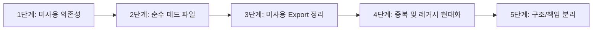

# 리팩토링 전문가 스킬 (Refactoring Standard)

이 문서는 안전하고 예측 가능한 코드 리팩토링, 데드 코드 정리, 기술 부채 해소를 수행하기 위한 전역 표준 절차서입니다.

---

## 1. 핵심 철학 및 원칙

1. **동작 보존 (Behavior Preservation)**
   - 리팩토링은 소프트웨어의 **외부 동작을 전혀 바꾸지 않고 내부 구조를 개선**하는 작업입니다.
   - 기능 추가(Feature)나 버그 수정(Fix)을 리팩토링 작업과 단일 커밋/PR에 섞지 않습니다.
2. **외과적 변경 (Surgical Changes)**
   - 한 번에 대규모로 구조를 뒤흔드는 빅뱅(Big Bang) 수정을 지양합니다.
   - 영향 범위가 명확한 원자적(Atomic) 단위로 나누어 점진적으로 변경합니다.
3. **이중 안전망 (Double Safety Net)**
   - 리팩토링 착수 전 기존 테스트 통과 상태를 먼저 확인(Baseline)합니다.
   - 변경 후 타입 검사, 테스트, 빌드를 순차 검증합니다.

---

## 2. 사전 작업: 리팩토링 대상 격리 가드 (Scope Quarantine)

리팩토링을 시작하기 전, **수정해서는 안 되는 코드**를 먼저 식별하고 격리합니다.

### 2.1. 폐기 예정 모듈 격리
- **원칙**: 차세대 시스템으로 이관 중이거나 곧 폐기될 레거시 코드는 **리팩토링 대상에서 완전히 제외**하여 불필요한 공수 낭비와 머지 충돌을 방지합니다.
- **식별 방법**:
  1. 프로젝트 GitHub 이슈의 마이그레이션/이관 추적 이슈 확인
  2. 코드 내 `@deprecated` 주석 및 비권장 공지 확인
  3. 프로젝트 문서(`AGENTS.md`) 내 이관 명세 확인
- **격리 규칙**:
  - ❌ 코드 수정 금지 (리팩토링, 스타일 정리, 린트 수정 금지)
  - ❌ 신규 테스트 추가 금지
  - ❌ 신규 코드에서의 import 연결 금지
  - ⚠️ 운영 중 긴급 핫픽스만 최소 범위로 허용

### 2.2. 정적 분석 도구 False Positive 방어
정적 분석 도구의 "미사용" 리포트를 맹신하지 않고 아래 패턴을 반드시 교차 검증합니다:
1. **프레임워크 특수 파일**: 라우트 파일, 엔트리포인트, 설정 파일 등 프레임워크가 암묵적으로 참조하는 파일
2. **코드 생성 산출물**: ORM 생성 코드, API 클라이언트 생성 코드 등
3. **배럴(Barrel) 및 Re-export 체인**: `index.ts`, `__init__.py` 등의 재수출 모듈
4. **외부 스크립트/CLI/설정 참조**: 셸 스크립트, CI 파이프라인, 설정 파일의 scripts 필드

---

## 3. 리팩토링 우선순위 파이프라인 (5단계)

리팩토링 작업은 리스크가 낮고 안전한 영역부터 단계적으로 진행합니다.



### 1단계: 미사용 의존성 제거 (Dead Dependencies)
- `package.json`, `requirements.txt`, `pyproject.toml` 등에서 전체 코드베이스 및 스크립트에서 전혀 참조되지 않는 패키지 식별.
- 교체된 레거시 라이브러리 제거.
- 패키지 매니저로 제거 후 의존성 트리 정리 및 빌드 확인.

### 2단계: 순수 데드 파일 제거 (Dead Files)
- 더 이상 import되지 않고 상위 라우트와 연결이 끊어진 고아 파일 식별.
- Git 이력에 영구 보존되므로 안심하고 `git rm`으로 완전 삭제.

### 3단계: 미사용 Export 정리 (Unused Exports)
- 외부 파일에서 import하지 않는 함수, 상수, 타입의 `export` 키워드 제거(파일 내부 private화) 또는 삭제.
- 단, 공용 라이브러리의 파츠는 일관성을 위해 보존 고려.

### 4단계: 중복 제거 및 레거시 현대화 (Duplication & Modernization)
- 중복 export 정리.
- 구형 패턴을 프로젝트 표준 스택으로 전환.
- 여러 모듈에 흩어진 유사 유틸리티 함수를 공용 헬퍼로 일원화.

### 5단계: 구조 개선 및 모듈 분리 (Structural Refactoring)
- 300줄 이상의 비대한 컴포넌트나 함수를 단일 책임 원칙(SRP)에 따라 분리.
- 깊은 중첩 조건문을 조기 반환(Guard Clause / Early Return)으로 평탄화.
- 비즈니스 로직과 프레젠테이션 계층의 관심사 분리.

---

## 4. 검증 파이프라인 (Verification)

리팩토링 단위 작업이 끝날 때마다 다음 검증을 순차적으로 수행합니다:

```bash
# 1. 타입 무결성 검증 (언어별)
# TypeScript: pnpm exec tsc --noEmit
# Python: mypy . 또는 pyright

# 2. 단위/통합 테스트
# Node.js: pnpm test
# Python: pytest

# 3. 빌드 무결성 검증
# Node.js: pnpm build
# Python: python -m build

# 4. 정적 분석 재확인 (선택적)
# Lint: eslint, ruff, flake8 등
```

---

## 5. 커밋 규약

1. **GitHub 이슈 연계**:
   - 리팩토링 태스크는 반드시 GitHub 이슈(#번호)와 연계하여 진행합니다.
   - 대규모 리팩토링은 상위 에픽 이슈를 두고 하위 이슈별로 독립 커밋을 생성합니다.
2. **커밋 메시지 규칙**:
   ```text
   refactor: #<이슈번호> <요약>
   ```
3. **원자적 커밋**:
   - 의존성 제거, 파일 삭제, 코드 구조 개선을 한 커밋에 뒤섞지 않고 단위별로 분리합니다.

---

## 6. 리팩토링 체크리스트

- [ ] 폐기 예정이거나 이관 중인 격리 모듈을 수정하고 있지 않은가?
- [ ] 정적 분석 결과 중 프레임워크/코드 생성 등의 False Positive를 걸러내었는가?
- [ ] 리팩토링과 새로운 기능 개발/버그 수정을 한 호흡에 진행하고 있지 않은가?
- [ ] 수정 후 테스트와 빌드가 정상 통과하는가?
- [ ] 삭제된 코드가 필요한 경우 Git 이력에서 복원할 수 있음을 인지하고 과감히 정리하였는가?
