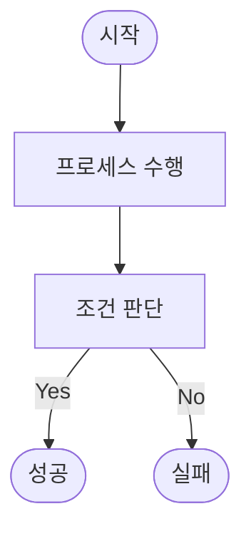
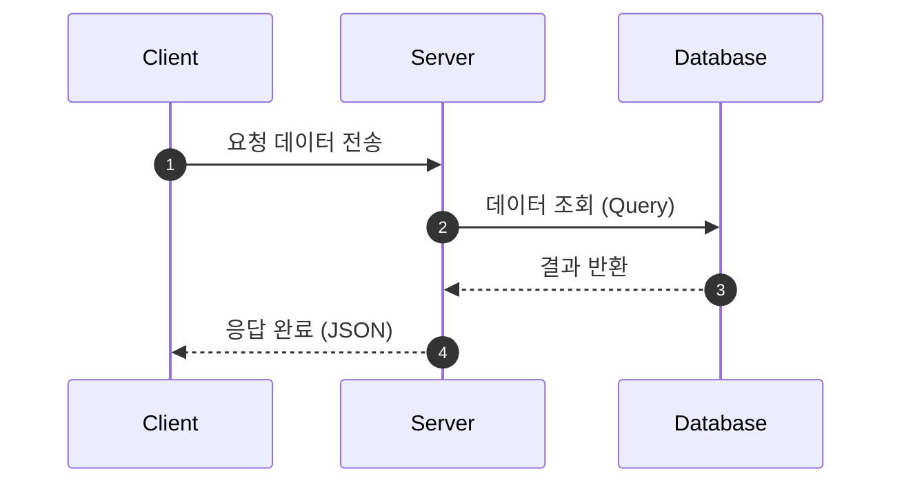
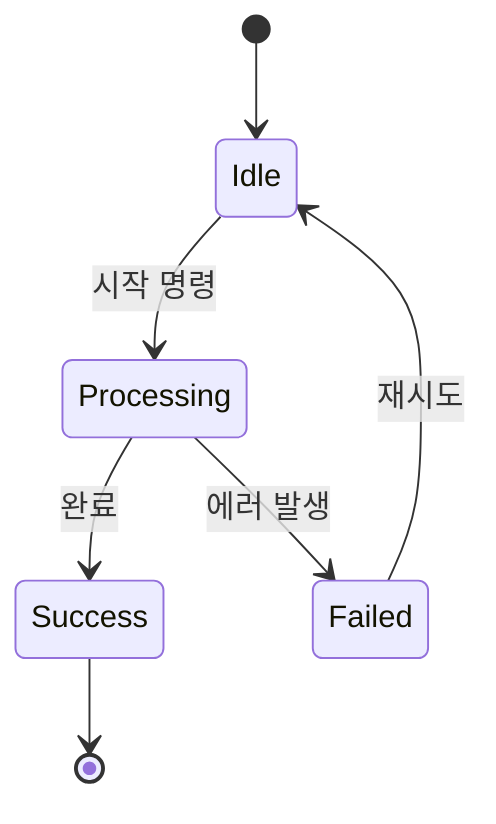
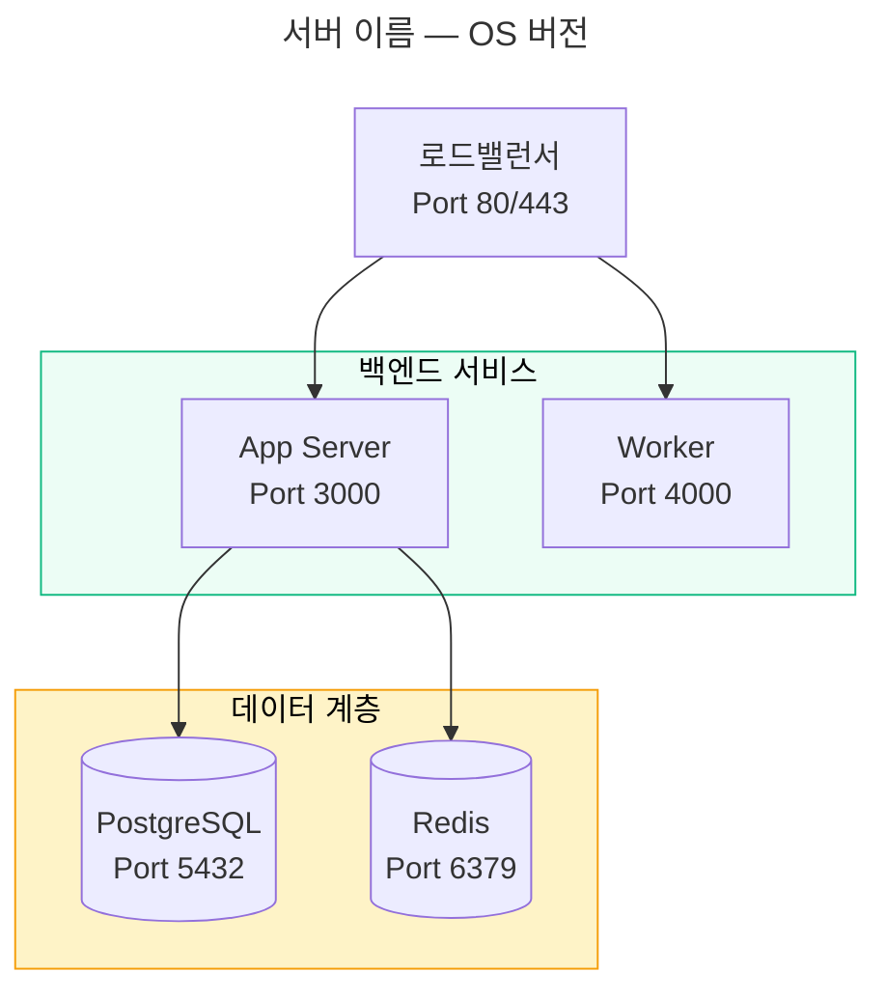

# Mermaid 다이어그램 활용 스킬 (use-mermaid)

이 스킬은 복잡한 시스템 아키텍처, 데이터 흐름, 상태 전환, 실행 단계 등을 시각화하여 사용자가 설계와 동작 방식을 한눈에 파악할 수 있도록 **Mermaid** 문법을 활용한 마크다운 다이어그램을 작성하기 위한 스킬이다.

## 1. 적용 시점 (When to use)
- 사용자가 순서도, 흐름도, 그림, 또는 시각적 설명을 요구할 때.
- `implementation_plan.md`, `walkthrough.md` 등 주요 기획/설계 문서에서 구조적인 설명을 강화할 때.
- 복잡한 로직이나 모듈 간의 의존성 및 호출 관계를 설명할 때.

## 2. 작성 원칙 및 모범 사례
- **올바른 레이아웃 선택**: 
  - 하향식 흐름은 `graph TD` (Top-Down)
  - 좌우 흐름은 `graph LR` (Left-to-Right)
- **문법 오류 방지 (Parse Error 예방)**:
  - **텍스트 내 줄바꿈(`\n`), 괄호`()`, 특수기호(예: `&`, `%`, `+` 등) 또는 공백이 포함된 경우**, 노드 정의 괄호(`[]`, `()`, `([])` 등) 내의 텍스트 전체를 **반드시 큰따옴표(`""`)로 감싸서 작성**한다. 그렇지 않으면 파서에 따라 심각한 `Parse error`를 유발하고 시각화가 완전히 실패한다.
  - ❌ **잘못된 예 (파싱 에러 유발):**
    - `B1[영업 및 계약 체결\n(판매자 A)]`
    - `C1[자가 창고 계약 (임대료 고정비 부담)]`
    - `E3[원거리 직접 출장 (시간 & 교통비 부담)]`
  - ✅ **올바른 예 (정상 작동):**
    - `B1["영업 및 계약 체결\n(판매자 A)"]`
    - `C1["자가 창고 계약 (임대료 고정비 부담)"]`
    - `E3["원거리 직접 출장 (시간 & 교통비 부담)"]`
  - 레이블 내부에는 원시 HTML 태그를 절대 직접 삽입하지 않다.
- **줄바꿈: `flowchart` 노드 텍스트에서는 반드시 `<br>`을 사용**:
  - `flowchart` / `graph` 다이어그램의 **노드 텍스트** 안에서 줄바꿈이 필요하면 **`<br>`을 사용**한다. `\n`은 리터럴 문자로 표시되어 `\nPort 3000` 같은 깨진 텍스트가 출력됩니다.
  - ❌ **잘못된 예 (\\n이 그대로 노출됨):**
    - `nginx["Nginx Docker\nPort 80/443\nSSL 터미네이션"]`
  - ✅ **올바른 예 (정상 줄바꿈):**
    - `nginx["Nginx Docker<br>Port 80/443<br>SSL 터미네이션"]`
  - **연결선(Edge) 레이블**에서도 `\n`은 동일하게 그대로 노출되므로, 괄호나 쉼표로 단일행 표기하거나 `<br>`을 사용한다.
  - 참고: `sequence diagram`에서는 `<br>`이 아닌 `\n`이 정상 작동한다. 다이어그램 유형에 따라 줄바꿈 방식이 다릅니다.
- **엣지 레이블(`|...|`) 안 괄호 `()` 절대 금지**:
  - 연결선 레이블 `|...|` 안에 괄호 `()`가 들어가면 Mermaid 파서가 **노드 모양 문법으로 오인**하여 `Parse error`를 발생시킨다.
  - ❌ **잘못된 예 (파싱 에러 유발)**:
    - `Issue -->|6. 해결 완료 (Patch Bump)| Notice`
    - `A -->|처리 결과 (성공)| B`
  - ✅ **올바른 예 (하이픈 또는 쉼표로 대체)**:
    - `Issue -->|6. 해결 완료 - Patch Bump| Notice`
    - `A -->|처리 결과, 성공| B`
  - **규칙 요약**: 엣지 레이블 안에는 괄호 `()` 대신 하이픈(`-`) 또는 쉼표(`,`)를 사용한다.
- **`block-beta` 다이어그램 사용 금지**:
  - `block-beta`는 중첩 블록의 행 높이가 자동 축소되어 텍스트가 보이지 않는 렌더링 버그가 빈번한다.
  - 대신 `flowchart TD` + `subgraph`를 사용하여 동일한 구조를 표현해라. 노드 크기가 내용에 맞게 자동 조절됩니다.
- **컴포넌트 그룹화**:
  - 논리적으로 묶을 수 있는 영역은 `subgraph`를 활용하여 경계를 명확하게 구분한다.
- **`subgraph` 제목 잘림 및 노드 줄바꿈 방지 (YAML 타이틀 사용)**:
  - `subgraph` 제목은 다이어그램 상단 경계선 위에 렌더링되므로 뷰어에 따라 **잘려서 보이지 않는 문제**가 빈번한다.
  - 이를 회피하기 위해 일반 노드를 제목처럼(`title_gabia(["제목"])`) 사용할 경우, 다이어그램 전체 폭이 넓어질 때 레이아웃 엔진(Dagre)이 **제목 노드의 텍스트를 강제로 여러 줄로 줄바꿈(Wrap)** 해버려 시각적으로 망가집니다.
  - **해결책**: 다이어그램 코드 블록 최상단에 **Mermaid 공식 YAML Frontmatter 타이틀 문법**을 사용한다. 이 방식은 노드 레이아웃과 완벽히 독립되어 렌더링되므로 잘림이나 강제 줄바꿈이 절대 발생하지 않다.
  - ❌ **잘못된 예 1 (subgraph 제목 잘림):** `subgraph gabia["가비아 서버"]`
  - ❌ **잘못된 예 2 (일반 노드를 제목으로 사용하여 강제 줄바꿈 발생):** `title(["가비아 서버"])`
  - ✅ **올바른 예 (공식 YAML 타이틀):**
    ```mermaid
    ---
    title: ✅ 가비아 서버 — Ubuntu 22.04 LTS
    ---
    flowchart TD
      nginx["Nginx"]
      subgraph docker_zone["Docker 영역"]
        ...
      end
    ```
  - **규칙 요약**: 다이어그램 전체 제목은 무조건 `--- title: 제목 ---` 형태의 YAML Frontmatter를 사용한다.
- **가로폭 과다 방지 및 다이어그램 분리 (두 줄 배치)**:
  - 서로 다른 흐름(예: 기존 프로세스 vs 개선 프로세스)을 비교할 때, 하나의 Mermaid 블록 내에서 여러 `subgraph`로 가로 병렬 배치하면 뷰어에서 글씨가 줌아웃(축소)되어 가독성이 극도로 나빠집니다.
  - 이 경우, **각 흐름을 독립된 Mermaid 코드 블록으로 쪼개어 마크다운 본문에 위아래(세로)로 순서대로 작성**하여 자연스럽게 두 줄로 렌더링되도록 처리한다. 복잡한 아키텍처 역시 컴포넌트별로 다이어그램을 분할하여 작성한다.

## 3. 자주 사용하는 다이어그램 템플릿

### A. 순서도 (Flowchart)


### B. 시퀀스 다이어그램 (Sequence Diagram)


### C. 상태 다이어그램 (State Diagram)


### D. 아키텍처 다이어그램 (YAML 타이틀 + subgraph 패턴)


## 4. 줄바꿈 방식 요약 (다이어그램 유형별)

| 다이어그램 유형 | 노드 텍스트 줄바꿈 | Edge 레이블 줄바꿈 |
| :--- | :--- | :--- |
| `flowchart` / `graph` | `<br>` 사용 | 단일행 권장 또는 `<br>` |
| `sequenceDiagram` | `\n` 사용 | `\n` 사용 |
| `stateDiagram` | 줄바꿈 미지원 | 단일행만 가능 |

## 5. 로컬 미리보기 환경 구성 (VS Code)
VS Code의 기본 마크다운 미리보기 창에서 Mermaid 다이어그램이 텍스트로 보이고 시각화되지 않는 경우, 아래의 VS Code 확장을 설치하시는 것을 강력히 권장한다.
- **공식 확장 기능**: [Mermaid Chart (mermaidchart.vscode-mermaid-chart)](https://marketplace.visualstudio.com/items?itemName=mermaidchart.vscode-mermaid-chart) — 공식 AI 기반 다이어그램 생성 및 편집 도구
- **가벼운 미리보기 연동**: [Markdown Preview Mermaid Support (bierner.markdown-mermaid)](https://marketplace.visualstudio.com/items?itemName=bierner.markdown-mermaid) — 마크다운 내장 뷰어와 연동되는 경량 렌더러

