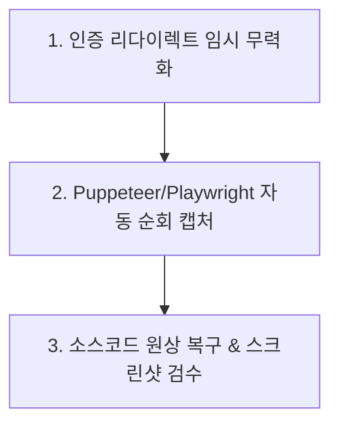

> **[안내]** 이 파일은 각 프로젝트가 복사해갈 때 프로젝트 상황에 맞게 수정하여 사용하는 템플릿이다.

# Verify Header Style — 전체 페이지 헤더 스타일 전수 검증 스킬

Puppeteer 또는 Playwright를 사용하여 프론트엔드의 **모든 페이지**를 순회하며 헤더 영역의 라이트/다크 모드 스타일을 스크린샷으로 캡처하고 시각적으로 전수 검증하는 가이드이다.

## 1. 이 스킬이 필요한 이유

* **레이아웃 일관성 누락 방지**: UI 디자인 시스템(헤더 토큰, 테두리, 라운드 등)을 전체 변경할 때 특정 페이지나 서브 라우트에서 스타일 반영이 누락되는 현상을 방지한다.
* **로그인 리다이렉트(Auth Wall) 우회**: 마이페이지, 어드민 등 인증이 필요한 페이지는 비로그인 시 401/로그인 페이지로 이동하여 단순 캡처 시 로그인 화면만 찍히는 문제를 해결한다.

---

## 2. 검증 프로세스 (3단계)



### 1단계: 인증 리다이렉트 임시 무력화 (Auth Bypass)
인증이 필요한 페이지에서도 UI 레이아웃만 렌더링되도록, 클라이언트 측 리다이렉트 구문을 `sed` 명령어로 임시 주석 처리한다.

```bash
# 예시: 라우터 리다이렉트 및 API 리다이렉트를 임시 무력화
sed -i 's/router.push(redirectUrl)/console.log("no redirect")/g' <project-root>/src/app/**/page.tsx
```

### 2단계: 자동 순회 및 다크 모드 크롭 캡처 (Auto-Traversal)
Puppeteer 스크립트를 실행하여 모든 페이지를 탐색하고 다크 모드를 강제 적용한 뒤 타겟 헤더 요소를 크롭 캡처한다.

```javascript
// capture_headers.js (템플릿 예시)
const puppeteer = require('puppeteer');
const fs = require('fs');
const path = require('path');

(async () => {
  const browser = await puppeteer.launch({ args: ['--no-sandbox'] });
  const page = await browser.newPage();
  
  // 다크 모드 활성화
  await page.emulateMediaFeatures([{ name: 'prefers-color-scheme', value: 'dark' }]);
  await page.setViewport({ width: 1280, height: 1080 });
  
  const urls = [
    'http://localhost:3000/',
    'http://localhost:3000/about',
    'http://localhost:3000/dashboard'
  ];

  for (let url of urls) {
    try {
      await page.goto(url, { waitUntil: 'networkidle0', timeout: 10000 });
      
      // 다크 클래스 주입
      await page.evaluate(() => {
        document.documentElement.classList.add('dark');
      });
      
      // 헤더 타겟 선택자
      const targetElement = await page.$('.header-container, header');
      if (targetElement) {
        const safeName = url.replace(/[^a-zA-Z0-9]/g, '_');
        await targetElement.screenshot({ path: `./captures/header_${safeName}.png` });
        console.log(`✅ 캡처 완료: ${url}`);
      }
    } catch (e) {
      console.log(`❌ 캡처 실패 (${url}): ${e.message}`);
    }
  }
  await browser.close();
})();
```

### 3단계: 임시 변경 사항 원상 복구 (Git Restore)
검증 캡처가 끝나면 반드시 Git 명령어를 통해 임시로 수정했던 코드들을 복구한다.

```bash
git checkout -- <project-root>/src/
```

---

## 3. 검증 항목 체크리스트

- [ ] 다크 모드에서 헤더 배경색이 배경 글레어(눈부심) 없이 올바른 어두운 톤인가?
- [ ] 테두리(Border)와 라운딩(Rounded) 스타일이 디자인 시스템 토큰과 일치하는가?
- [ ] 텍스트 컬러가 가독성 대비 기준(WCAG AA 이상)을 만족하는가?
- [ ] 모바일/데스크톱 해상도 반응형 깨짐이 없는가?
