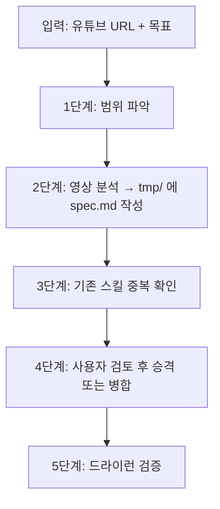

# 유튜브 튜토리얼 스킬 변환 전문가 (youtube-to-skill)

유튜브에 공개된 코딩, 인프라, AI 도구 튜토리얼 영상을 시청·분석하여, AI 에이전트가 즉시 재사용할 수 있는 정밀한 실행 스킬(`SKILL.md`)로 추출·제작한다.

영상 제목이나 요약문만 보고 지어내는 **환각(Hallucination)을 원천 차단**하고, 튜토리얼 특유의 **"생략된 전제조건"과 "화면 밖 함정"**을 집어내어 실제로 돌아가는 스킬을 굽는 것을 목표로 한다.

---

## 1. 핵심 분석 프레임워크 (6대 필수 추출 항목)

영상을 분석할 때 아래 6가지 항목을 반드시 순서대로 추출하여 정리합니다:

1. **무엇을 만드는가 (Outcome)**:
   - 홍보성 문구나 과장 없이 실제 완성되는 결과물, 동작 방식, 입력과 출력을 한 문단으로 정의.
2. **필요한 것 (Prerequisites)**:
   - 화면에 등장하거나 음성으로 언급된 도구, CLI 유틸리티, 패키지, 라이브러리 버전, 계정, API 키.
   - 유료 결제가 필요한 항목이나 사전 권한 요구사항 명시.
3. **명령어와 설정 글자 그대로 (Verbatim Commands & Configs)**:
   - 화면에 입력된 명령어, 파일 경로, 환경변수, 설정값을 보이는 그대로 인용.
   - 화면이 흐릿하거나 영상 편집으로 잘려 식별할 수 없는 부분은 절대 임의로 짐작하지 않고 `UNREADABLE`로 명시.
4. **만드는 실제 순서 (Step-by-Step Sequence)**:
   - 강사가 실제로 진행한 순서대로 기록 (도중에 실패하여 되돌리거나 수정한 내역 포함).
   - "시간 관계상 미리 만들어 둔 파일로 교체"하거나 완성본 화면으로 건너뛴 지점은 건너뛰었다고 명시.
5. **화면 밖 함정 및 경고 (Pitfalls & Side Notes)**:
   - 영상 중 발생한 오류 로그, 강사가 말로 덧붙인 *"이건 미리 켜두셔야 해요"*, OS별 권한 문제 등 숨겨진 경고 전부 기록.
6. **영상이 보여주지 않은 숨은 전제조건 (Hidden Steps)**:
   - 녹화 전에 이미 세팅해 둔 환경, 어디선가 화면 밖에서 복사해 온 토큰/설정값, 말로만 설명하고 넘어간 설치 단계.

---

## 2. 검증 딱지 시스템 (Tagging)

### 현재 운용 방식: 단일 소스 신뢰도 표기

현재는 자막 추출(`yt-dlp`) 기반의 **단일 소스 분석만 수행**한다. Gemini API를 통한 네이티브 영상 시청(2차 독립 분석)은 **의도적으로 수행하지 않는다.** 당장 영상을 전수 시청하고 교차검증할 만큼 긴급하거나 중요한 작업이 없기 때문이며, 필요해지면 그때 도입한다.

따라서 딱지의 실제 의미는 다음과 같다:

- `[확인됨]`: 자막에서 명확하게 언급되었고, 명령어나 설정값이 구체적으로 특정 가능한 항목. 단, **교차검증된 것이 아니라 "자막에 분명히 있었다"는 뜻**이다.
- `[한쪽만]`: 자막에 직접 언급되지 않았으나 에이전트가 맥락상 추론한 항목 (예: 영상에서 다루지 않은 `.env` 복사 필요성, 플랫폼별 차이 등). **신뢰도가 가장 낮으므로 사용자가 직접 확인해야 한다.**
- `[충돌]`: 자막 내에서 앞뒤 설명이 모순되거나, 에이전트의 사전 지식과 자막 내용이 불일치하는 지점. 두 내용을 모두 적고 사용자에게 판단을 요청한다.

### 교차검증이 필요해질 경우

영상 내용의 정확도가 중요한 프로덕션 스킬을 만들 때는, `google-genai` 패키지를 설치하고 Gemini API로 유튜브 URL을 직접 시청시켜 2차 독립 분석을 수행할 수 있다. 그때 딱지의 의미는 본래 설계 의도대로 "두 독립 소스가 일치하는가"로 격상된다.

---

## 3. 실행 단계별 절차

### 1단계: 분석 범위 파악
- 사용자가 유튜브 URL과 함께 원하는 기능 범위를 제공했는지 확인한다.
- 영상 길이가 20분을 초과하는 긴 튜토리얼인 경우, 전체를 포괄하기보다 사용자가 원하는 특정 섹션이나 핵심 구축 구간을 좁혀서 분석하도록 권장한다.

### 2단계: 영상 분석 및 설계도(`spec.md`) 작성
- 에이전트 환경에서 지원하는 비디오 분석 수단(Gemini 네이티브 영상 이해 기능, 자막 추출기, 프레임 캡처 등)을 활용해 영상을 시청한다.
- 6대 필수 추출 항목에 맞추어 분석하고, 각 항목에 `[확인됨]`, `[한쪽만]`, `[충돌]` 태그를 붙이다.
- **모든 중간 산출물은 임시 작업 폴더에 저장합니다** (예: `tmp/youtube-analysis/<영상ID>/spec.md`).
  - `library/skills/`에 직접 생성하면 안 됩니다. 이곳은 검증이 끝난 최종 스킬만 보관하는 곳이다.

### 3단계: 기존 스킬 중복 확인
- `spec.md` 작성 후, 라이브러리에 동일하거나 유사한 주제의 기존 스킬이 있는지 반드시 확인한다.
- 중복 스킬이 있으면 신규 생성 대신 기존 스킬에 누락된 내용을 **병합**하는 방향을 우선 제안한다.

### 4단계: 사용자 검토 후 승격
- `spec.md`와 초안 `SKILL.md`(둘 다 `tmp/` 안에 위치)를 사용자에게 제시한다.
- 사용자 승인 후에만 최종 목적지로 이동합니다:
  - 글로벌 범용 스킬: `library/skills/<skill-name>/SKILL.md`로 승격
  - 기존 스킬 보강: 기존 스킬 파일에 병합
  - 특정 프로젝트 전용: 해당 프로젝트의 `.agents/skills/<skill-name>/SKILL.md`
- `spec.md`는 승격된 스킬 폴더 안에 참조 문서로 함께 보관한다.

### 5단계: 첫 실행 검증
- 승격된 스킬을 실제 샘플 입력으로 한 번 드라이런(Dry-run)하거나 문법/로직 무결성을 확인한다.
- 부족하거나 깨진 부분이 있다면 즉시 보정한다.

---

## 4. 자주 발생하는 실수와 방어 규칙

1. **시간 표시 맹신 금지**:
   - 영상의 몇 분 몇 초 같은 타임스탬프는 편집이나 재생 속도에 따라 왜곡되므로, "어떤 순서로 무엇을 실행했는가"라는 인과 관계를 중심에 둡니다.
2. **매끄러운 일반론 경계**:
   - LLM이 사전 학습된 지식으로 얼버무린 매끄러운 튜토리얼 설명보다, 해당 영상 강사가 실제로 부딪힌 특이한 버그와 설정 옵션을 우선한다.
3. **만들고 검증 건너뛰기 금지**:
   - 설계도만 예쁘게 뽑고 실제 실행 규칙 검증을 거치지 않은 스킬은 "요약본"일 뿐이다. 에이전트가 바로 호출할 수 있는 구체적인 가이드로 완성해야 한다.
