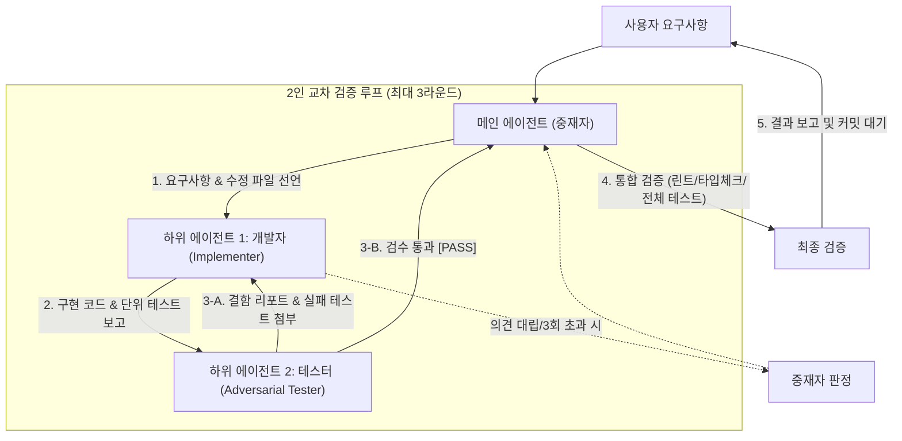

# invite-tester 워크플로우 (개발자·테스터 2인 교차 검증)

이 워크플로우는 구현자(Developer)와 비판적 검수자(Adversarial Tester) 역할을 명확히 분리하여,  
확증 편향을 원천 차단하고 결점 없는 코드를 완성하는 **2인 에이전트 교차 검증 파이프라인**을 실행합니다.

---

## 1. 아키텍처 및 역할 분담

---

## 2. 단계별 실행 절차

### 1단계: 스킬 활성화 및 수정 범위 선언 (중재자)
- `invite-tester` 스킬을 활성화합니다.
- 사용자 요구사항을 분석하고, 수정/생성할 **허용 파일 목록(Scope)**과 완료 기준을 선언합니다.

### 2단계: 개발자 하위 에이전트 위임 (Implementer)
- 개발자 에이전트에게 요구사항과 허용 파일 목록을 전달합니다.
- **개발자 임무**:
  1. 선언된 파일 범위 내에서 외과적 코드 구현 (과잉 설계 금지)
  2. 정상 케이스(Happy path) 단위 테스트 작성 및 통과 확인
  3. 구현 요약 및 자체 테스트 결과 보고

### 3단계: 테스터 하위 에이전트 위임 (Adversarial Tester)
- 테스터 에이전트에게 변경된 코드와 diff를 전달하고 비판적 검수를 지시합니다.
- **테스터 임무**:
  1. 경계값, `null`/`undefined`, 비동기 레이스 등 엣지 케이스 공격
  2. 7대 안티패턴(비동기 await 누락, 스키마 불일치, 임의 하드코딩 등) 전수 검사
  3. 결함 발견 시 **실패하는 재현 테스트 코드** 첨부
  4. 모든 조건 충족 시 `[PASS]`, 결함 발견 시 `[FAIL]` 판정 보고

### 4단계: 핑퐁 피드백 루프 (최대 3라운드)
- **테스터 FAIL 보고 시**:
  - 중재자가 라운드 수를 카운트하고, 개발자에게 결함 리포트와 재현 테스트를 넘겨 수정을 요구합니다.
  - 수정 완료 후 테스터가 재검수합니다.
  - **3회 초과 시 (회로 차단기)**: 중재자가 직접 개입하여 치명도(Blocking 여부)를 판정하고 필요시 사용자에게 에스컬레이션합니다.
- **테스터 PASS 보고 시**:
  - 루프를 성공적으로 완료하고 5단계로 진입합니다.

### 5단계: 중재자 통합 검증 및 사용자 보고
- 메인 에이전트가 전체 프로젝트의 린트, 타입 체크, 전체 테스트 스위트를 최종 확인합니다.
- 사용자에게 아래 양식으로 결과를 보고합니다:
  - **구현 요약 및 변경 파일 목록**
  - **교차 검증 라운드 경과** (예: 1차 2건 결함 수정 후 2차 전원 통과)
  - **테스터가 보강한 방어 테스트 목록**
  - **통합 검증 결과** (Type-check / Test 상태)
